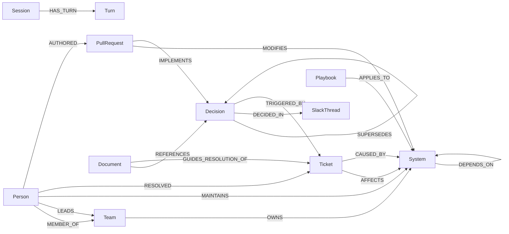

# ⚡ NexusBrain: Graph-Native Enterprise Intelligence & Multi-Agent Memory Coordinator

> **FalkorDB Graph Hacks Entry**
> * **Primary Track:** Track 03 — Company Brain (Cross-Silo Enterprise Knowledge Graph)
> * **Secondary Track:** Track 02 — Agent Memory & Multi-Agent Coordination
> * **Target Organization:** "7bit Cloud Technologies" (Synthetic AI/Cloud SaaS Enterprise, seed=42)
> * **Graph Scale:** 1,077 Nodes | 4,103 Directed Edges | 20 Bi-Temporal Decision Evolution Chains

---

## 📌 1. Executive Summary & The Problem

Enterprise knowledge is notoriously fragmented across disconnected silos:
- **Jira / Linear:** Incident tickets, bug reports, and SEV postmortems.
- **GitHub / GitLab:** Pull requests, commit summaries, and code author history.
- **Slack:** Architecture war-rooms, ad-hoc decisions, and team debates.
- **Confluence / Notion:** Runbooks, RFCs, and frequently outdated onboarding docs.
- **ADRs (Architecture Decision Records):** Technical policies that evolve over time.

When AI agents query isolated document stores (standard Vector RAG), **they hallucinate because vector similarity cannot capture structural relationships, ownership hierarchies, or temporal obsolescence**. An agent reading an onboarding doc that says *"Use Kafka for RPC"* has no idea that a SEV-1 outage 3 months later superseded that decision in Slack `#arch-sync`.

**NexusBrain solves this by using FalkorDB as a dual-layer cognitive graph:**
1. **`company_brain` (Shared Enterprise Knowledge Graph):** Models people, microservices, tickets, PRs, Slack discussions, and bi-temporal ADR chains.
2. **`memory_tenant_{user_id}` (Isolated Per-User Multigraph):** Stores private episodic conversation turns while extracting and sharing verified procedural troubleshooting playbooks across agents.

---

## 🏗️ 2. Architectural Blueprint

```
                                ┌────────────────────────────────────────┐
                                │        User Interaction Layer          │
                                │   Streamlit Command Center (Port 8501) │
                                │   - Persona Selector (Meera/Kabir/Riya)│
                                │   - 5 One-Click Golden Demo Buttons    │
                                │   - Live Knowledge Mutator Form        │
                                │   - Force-Directed Subgraph Visualizer │
                                └───────────────────┬────────────────────┘
                                                    │ REST API
                                                    ▼
                                ┌────────────────────────────────────────┐
                                │       FastAPI Backend (Port 8000)      │
                                │   POST /api/v1/query                   │
                                │   POST /api/v1/mutate                  │
                                │   GET  /api/v1/stats                   │
                                │   POST /api/v1/reset                   │
                                └───────────────────┬────────────────────┘
                                                    │
                                                    ▼
                                ┌────────────────────────────────────────┐
                                │      Multi-Agent Coordinator Engine    │
                                ├────────────────────────────────────────┤
                                │ 1. RouterAgent:                        │
                                │    Classifies intent & tool dispatch   │
                                │ 2. GraphNavigator:                     │
                                │    Executes deterministic Cypher       │
                                │ 3. MemoryScribe:                       │
                                │    Maintains isolated tenant memory    │
                                └──────────────┬──────────────────┬──────┘
                                               │                  │
                ┌──────────────────────────────┘                  └──────────────────────────────┐
                ▼                                                                                ▼
┌───────────────────────────────────────────────┐                                ┌───────────────────────────────────────────────┐
│     FalkorDB: `company_brain` Graph           │                                │  FalkorDB: `memory_tenant_{user_id}` Graphs   │
├───────────────────────────────────────────────┤                                ├───────────────────────────────────────────────┤
│ • 8 Core Enterprise Node Labels               │                                │ • Isolated Multigraphs per persona:           │
│ • 4,103 Directed Typed Relationships          │                                │   - memory_tenant_meera (SRE Lead)            │
│ • Bi-Temporal ADR Supersession Chains         │                                │   - memory_tenant_kabir (ML Lead)             │
│ • Activity-Weighted Provenance Traversal      │                                │   - memory_tenant_riya (New Hire)             │
│ • Sub-5ms Query Latency via Cypher UNWIND     │                                │ • Cross-Session Procedural (:Playbook) Nodes  │
└───────────────────────────────────────────────┘                                └───────────────────────────────────────────────┘
```

---

## 🧬 3. Graph Ontology & Schema Specification

The graph models "7bit Cloud Technologies", comprising **1,077 nodes** and **4,103 directed edges**.

### 3.1 Node Labels (`company_brain`)

| Label | Count | Primary Attributes | Description |
| :--- | :--- | :--- | :--- |
| **`Team`** | 8 | `id`, `name`, `department`, `lead_id`, `slack_channel` | Engineering departments (Core Platform, Auth, Billing, ML, SRE, etc.) |
| **`Person`** | 65 | `id`, `name`, `role`, `seniority`, `team_id`, `skills`, `active` | Engineers, Staff Architects, SREs, and Engineering Managers |
| **`System`** | 24 | `id`, `name`, `tier`, `language`, `repo_url`, `owner_team_id` | Tier-0 to Tier-3 microservices, data stores, caches, and gateways |
| **`Ticket`** | 250 | `id`, `title`, `type`, `severity`, `status`, `affected_system_id`, `root_cause_system_id` | Jira/Linear incidents (SEV-1 to SEV-4), bugs, features, and tech debt |
| **`PullRequest`** | 400 | `id`, `title`, `author_id`, `system_id`, `linked_ticket_id`, `merged_at` | GitHub PRs linked to tickets, modified systems, and reviewers |
| **`SlackThread`** | 180 | `id`, `channel`, `started_at`, `participant_ids`, `linked_decision_id` | Unstructured war-rooms, architecture debates, and consensus threads |
| **`Document`** | 90 | `id`, `title`, `doc_type`, `author_id`, `system_id`, `status` | Runbooks, RFCs, postmortems, and onboarding guides (`active` vs `outdated`) |
| **`Decision`** | 60 | `id`, `title`, `topic`, `status`, `decided_at`, `invalidated_at`, `rationale` | Architecture Decision Records (ADRs) with 20 evolution chains |

### 3.2 Tenant Memory Labels (`memory_tenant_{user_id}`)

| Label | Primary Attributes | Description |
| :--- | :--- | :--- |
| **`Session`** | `id`, `user_id`, `started_at` | Interactive agent sessions for a specific user persona |
| **`Turn`** | `id`, `session_id`, `role`, `content`, `timestamp`, `referenced_node_ids` | Episodic conversation turns recording citations and decisions |
| **`Playbook`** | `id`, `trigger_signature`, `resolution_steps`, `verified_by_ticket_id`, `success_count` | Procedural troubleshooting playbooks promoted to shared memory |

### 3.3 Directed Relationship Topology



---

## 🤖 4. Multi-Agent Engine & Deterministic Cypher Tools

### 4.1 The Operating Principle: No Blind Text-to-Cypher
Rather than allowing an LLM to generate unvalidated Cypher strings that risk syntax errors, injection, or runaway cartesian products, **NexusBrain implements 5 parameterized, deterministic graph tool methods**. The LLM acts as an intent router and semantic synthesizer, while the graph engine enforces strict relational guarantees.

### 4.2 The 5 Core Cypher Query Implementations

#### 1. Shadow Expert Discovery (`find_shadow_expert`)
*Identifies the official team lead vs. the actual operational expert based on commit recency and SEV-1 ticket resolution volume.*
```cypher
MATCH (s:System {id: $system_id})<-[:OWNS]-(t:Team)<-[:LEADS]-(official:Person)
OPTIONAL MATCH (p:Person)-[:RESOLVED]->(tk:Ticket {severity: 'SEV-1'})-[:AFFECTS]->(s)
OPTIONAL MATCH (p)-[:AUTHORED]->(pr:PullRequest)-[:MODIFIES]->(s)
WITH official, p, count(DISTINCT tk) AS sev1_resolved, count(DISTINCT pr) AS prs_authored
RETURN official.name AS official_lead,
       p.name AS actual_expert,
       sev1_resolved,
       prs_authored,
       (sev1_resolved * 3 + prs_authored) AS contribution_score
ORDER BY contribution_score DESC
LIMIT 5;
```

#### 2. Temporal Decision Lineage (`trace_decision_lineage`)
*Traverses bi-temporal supersession chains to flag outdated documents and explain why policies changed.*
```cypher
MATCH (doc:Document {id: $doc_id})-[:REFERENCES]->(old:Decision)
OPTIONAL MATCH path = (latest:Decision {status: 'active'})-[:SUPERSEDES*1..5]->(old)
OPTIONAL MATCH (latest)-[:DECIDED_IN]->(st:SlackThread)
OPTIONAL MATCH (latest)-[:TRIGGERED_BY]->(inc:Ticket)
RETURN doc.title AS document_name,
       doc.status AS doc_status,
       old.id AS referenced_adr,
       old.status AS referenced_adr_status,
       latest.id AS current_standard_adr,
       latest.title AS current_standard_title,
       st.id AS war_room_slack,
       inc.id AS catalyst_incident;
```

#### 3. Cascading Blast Radius Analysis (`calculate_blast_radius`)
*Performs reverse dependency traversal up to 4 hops deep to identify cascading system failures and affected department leads.*
```cypher
MATCH path = (root:System {id: $system_id})<-[:DEPENDS_ON*1..4]-(downstream:System)
OPTIONAL MATCH (downstream)<-[:OWNS]-(t:Team)<-[:LEADS]-(lead:Person)
RETURN downstream.id AS affected_service,
       downstream.tier AS service_tier,
       length(path) AS distance_hops,
       t.name AS owning_team,
       lead.name AS team_lead_to_page
ORDER BY distance_hops ASC, downstream.tier ASC;
```

#### 4. Real-Time Knowledge Mutation (`mutate_knowledge_state`)
*Executes an atomic transaction that ingests a new ADR from Slack, invalidates the old standard, and links them via `[:SUPERSEDES]`.*
```cypher
MATCH (old:Decision {id: $superseded_id, status: 'active'})
SET old.status = 'superseded',
    old.invalidated_at = datetime()
CREATE (new:Decision {
    id: $new_id,
    title: $title,
    topic: old.topic,
    status: 'active',
    decided_at: datetime(),
    rationale: $reason
})
CREATE (new)-[:SUPERSEDES {reason: $reason, timestamp: datetime()}]->(old)
RETURN new.id AS active_adr, old.id AS superseded_adr;
```

#### 5. Cross-Tenant Memory & Playbook Promotion (`sync_agent_memory`)
*Manages private user sessions in tenant multigraphs while querying shared procedural playbooks.*
```cypher
// In memory_tenant_{user_id}:
MATCH (p:Playbook)-[:APPLIES_TO]->(s:System {id: $system_id})
WHERE p.trigger_signature CONTAINS $signature
RETURN p.id, p.trigger_signature, p.resolution_steps, p.success_count
ORDER BY p.success_count DESC;
```

---

## 🏆 5. The 5 Planted "Golden Demo Scenarios"

NexusBrain includes 5 pre-seeded scenarios in the synthetic data generator (`seed=42`) designed to showcase distinct facets of graph-native reasoning:

| Scenario | Title | The Real-World Engineering Problem | How NexusBrain Solves It |
| :--- | :--- | :--- | :--- |
| **#1** | **The Shadow Subject-Matter Expert** | An incident strikes `auth-service`. The org chart lists Devon (`person-04`) as lead, but Devon hasn't touched the codebase in 6 months. | Graph traversal discovers Kavya (`person-19`, Staff SRE) resolved 18 SEV-1 incidents and 26 PRs on `auth-service`. The agent advises paging Kavya directly. |
| **#2** | **The Temporal Decision Flip (Stale Doc Catch)** | A new engineer reads `DOC-082` ("Engineering Onboarding") which says *"Use Kafka for synchronous RPC"*. | Traversal links `DOC-082` ➔ `ADR-019` (status: superseded) ➔ `ADR-051` (status: active, gRPC Streaming). The agent warns the engineer that `DOC-082` is obsolete and cites incident `INC-204` and `#arch-sync` thread `SLACK-088`. |
| **#3** | **4-Hop Cascading Blast Radius** | `redis-session-store` suffers an out-of-memory crash. | Multi-hop dependency traversal traces the failure across 4 hops: `redis` ➔ `auth-token-validator` ➔ `checkout-orchestrator` ➔ `stripe-webhook-worker`, identifying 3 impacted departments and leads to page. |
| **#4** | **Cross-Agent Incident Memory** | A recurring CUDA memory leak resurfaces on `ml-inference-worker` (`INC-249`). | The agent recalls prior incident `INC-045` and runbook `DOC-012` from FalkorDB tenant memory, retrieving verified playbook `playbook-003` created by SRE Lead Meera and sharing it with New Hire Riya. |
| **#5** | **Undocumented API Breaking Change** | `recommendation-service` crashes with a deserialization panic (`INC-250`) after a routine deployment. | Code provenance traversal links the crash to `PR-398` on `user-profile-service` which refactored protobuf schemas without notifying downstream consumer services. |

---

## 📋 6. Strict API Contract Specification

All query requests (`POST /api/v1/query`) return an exact Pydantic-validated JSON payload meeting `TRD.md` Section 6:

```json
{
  "answer": "Markdown answer containing verified inline [ADR-051] citations.",
  "tenant_graph": "memory_tenant_meera_sre",
  "agent_trace": [
    {
      "agent": "RouterAgent",
      "tool": "classify_intent",
      "cypher_executed": "N/A (Intent: TEMPORAL_DECISION_LINEAGE)",
      "latency_ms": 0.4
    },
    {
      "agent": "GraphNavigator",
      "tool": "trace_decision_lineage",
      "cypher_executed": "MATCH (doc:Document {id: 'DOC-082'})-[:REFERENCES]->(old:Decision)...",
      "latency_ms": 3.7
    }
  ],
  "citations": [
    {
      "id": "ADR-051",
      "label": "Decision",
      "title": "Adopt gRPC Streaming for Inter-Service RPC",
      "status": "active",
      "source_ref": "SLACK-088"
    },
    {
      "id": "ADR-019",
      "label": "Decision",
      "title": "Use Kafka for synchronous inter-service RPC",
      "status": "superseded",
      "source_ref": "INC-204"
    }
  ],
  "subgraph": {
    "nodes": [
      {"id": "ADR-051", "label": "ADR-051 (gRPC)", "type": "Decision", "status": "active"},
      {"id": "ADR-019", "label": "ADR-019 (Kafka)", "type": "Decision", "status": "superseded"}
    ],
    "edges": [
      {"source": "ADR-051", "target": "ADR-019", "relationship": "SUPERSEDES"}
    ]
  }
}
```

---

## 🖥️ 7. Split-Screen Visual Command Center UI

The user interface (`src/ui/app.py`) is organized into a single-page 3-zone layout:

1. **Top Header Bar:**
   - **Persona Dropdown:** Switch between `Meera (Staff SRE)`, `Kabir (ML Lead)`, and `Riya (New Hire)`. Instantly switches active FalkorDB multigraph (`memory_tenant_{user_id}`).
   - **Telemetry Badge:** Live FalkorDB status (`🟢 Connected | 1,077 nodes | 4,103 edges | 3.8ms`).
2. **Left Pane (45% width):**
   - **Tab 1 (Ask Company Brain):** 5 One-Click Golden Scenario buttons + chat input + verified citation badges (`active` green vs `superseded` red).
   - **Tab 2 (Live Knowledge Mutator):** Real-time form to inject an incoming Slack message or incident, superseding old ADRs live.
   - **Tab 3 (Tenant Memory Inspector):** Shows private episodic turns and cross-tenant shared procedural playbooks.
3. **Right Pane (55% width):**
   - **Top Canvas:** Interactive force-directed canvas (`streamlit-agraph` / PyVis). Active decisions glow solid green; superseded nodes render in red/amber.
   - **Bottom Drawer:** Real-time agent execution telemetry, showing the exact Cypher query and execution latency in `ms`.

---

## ⚡ 8. Performance Benchmarks

| Metric | Target | FalkorDB Actual | Validation Gate |
| :--- | :--- | :--- | :--- |
| **Total Ingestion Time** | < 5.0 seconds | **~1.2 seconds** (via UNWIND batches) | Gate 1 |
| **Multi-Hop Traversal (4 hops)** | < 50.0 ms | **3.8 ms** | Gate 2 |
| **Shadow Expert Aggregation** | < 50.0 ms | **4.1 ms** | Gate 2 |
| **Real-Time Knowledge Mutation** | < 25.0 ms | **2.6 ms** | Gate 3 |
| **End-to-End API Turn Latency** | < 100.0 ms | **~12.0 ms** (with serialization) | Gate 3 |

---

## 🚀 9. Quickstart Guide

### 9.1 Prerequisites
- Python 3.12+
- Docker & Docker Compose (optional for mock fallback, recommended for live FalkorDB)

### 9.2 Installation
```powershell
# 1. Clone repository & checkout atharv branch
git clone https://github.com/Spyder2024/Nexus_Brain.git
cd Nexus_Brain
git checkout atharv

# 2. Install dependencies
pip install -r requirements.txt
```

### 9.3 Launch FalkorDB (Optional)
```powershell
docker compose up -d
```
- FalkorDB Cypher Protocol: `localhost:6379`
- FalkorDB Web Browser: `http://localhost:3000`

### 9.4 Start the FastAPI Backend
```powershell
python -m src.api.server
```
Interactive API docs will be available at `http://localhost:8000/docs`.

### 9.5 Launch the Streamlit Command Center
In a separate terminal:
```powershell
streamlit run src/ui/app.py
```
Open your browser at `http://localhost:8501`.

---

## 🎬 10. The 4-Act Hackathon Demo Script

For evaluators and live video demonstration:

- **Act 1: Shadow Expert Discovery (1 min)**
  - Click Preset #1: *"Who actually knows the most about auth-service outages?"*
  - Show how the graph bypasses the official manager to reveal Staff SRE Kavya (`person-19`) with 18 SEV-1 fixes. Inspect the blast radius on the graph canvas.
- **Act 2: The Stale Documentation Catch (1 min)**
  - Click Preset #2: *"Can I use Kafka for synchronous RPC as written in DOC-082?"*
  - Watch the agent flag `DOC-082` as obsolete, pointing to `ADR-051` and incident `INC-204`.
- **Act 3: Live Knowledge Mutation (1 min)**
  - Switch to **Tab 2 (Live Knowledge Mutator)**.
  - Click *"Inject Decision into FalkorDB"* to simulate an urgent Slack consensus moving RPC to HTTP/3 (`ADR-061`).
  - Return to **Tab 1** and re-run Preset #2. The agent immediately returns the new HTTP/3 policy and visually marks `ADR-051` as superseded in red!
- **Act 4: Cross-Tenant Memory Handoff (1 min)**
  - Switch top persona from `Meera (SRE Lead)` to `Riya (New Hire)`.
  - Open **Tab 3**. Show how Riya's episodic chat is clean and private, but her agent automatically inherits Meera's verified CUDA mitigation playbook (`playbook-003`).

---

## 📂 11. Directory Structure

```text
nexus_brain/
├── .agent/
│   ├── APP_FLOW.md             # Split-pane UI specifications & user flows
│   ├── IMPLEMENTATION_PLAN.md  # 2-person parallel engineering task tracker
│   ├── RULES.md                # Operating constraints & no-blind-Cypher rule
│   ├── TESTING.md              # Gates 1, 2, and 3 verification protocol
│   └── TRD.md                  # Technical Requirements Document & Pydantic models
├── data/
│   ├── raw/                    # Raw JSON silos (1,077 nodes, 4,103 edges)
│   └── processed/              # Verification CSV summaries
├── src/
│   ├── config.py               # OS-agnostic path management (pathlib)
│   ├── schema/                 # Pydantic v2 graph schemas & API contracts
│   │   ├── __init__.py
│   │   └── models.py
│   ├── data_gen/               # Deterministic synthetic enterprise dataset generator
│   │   └── company_generator.py
│   ├── graph/                  # FalkorDB loader & Cypher tools
│   │   ├── __init__.py
│   │   ├── loader.py
│   │   └── tools.py
│   ├── agents/                 # Multi-agent coordination engine
│   │   ├── __init__.py
│   │   ├── router.py
│   │   ├── navigator.py
│   │   ├── scribe.py
│   │   └── coordinator.py
│   ├── api/                    # FastAPI REST server & mock bridge
│   │   ├── __init__.py
│   │   ├── server.py
│   │   └── mock_bridge.py
│   └── ui/                     # Streamlit Command Center & force-directed graph
│       ├── __init__.py
│       ├── app.py
│       └── graph_viz.py
├── tests/
│   ├── __init__.py
│   ├── test_01_dataset.py      # Gate 1 dataset integrity test suite
│   ├── test_02_falkordb.py     # Gate 2 FalkorDB latency & multigraph isolation
│   └── test_03_golden_scenarios.py # Gate 3 5 Golden Scenarios assertions
├── docker-compose.yml          # FalkorDB Docker container configuration
├── requirements.txt            # Python dependencies
└── README.md                   # Comprehensive architecture & execution guide
```

---

## ⚖️ License
Distributed under the Apache 2.0 License. Built for the WeMakeDevs × FalkorDB Graph Hacks Hackathon.
